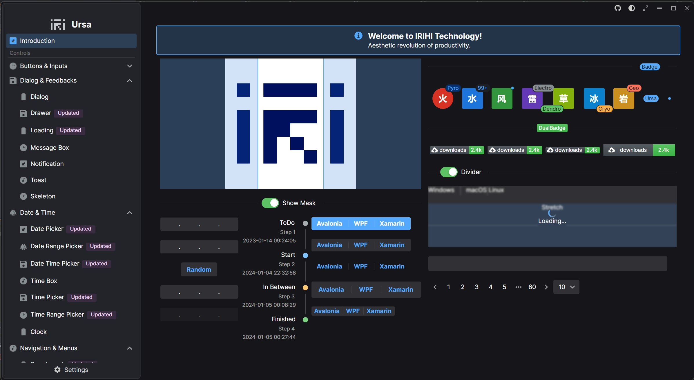

# Ursa

English | [简体中文](README.zh-CN.md)

<p align="center">
    
</p>

[](https://www.nuget.org/packages/Irihi.Ursa/)
[](https://www.nuget.org/packages/Irihi.Ursa/)
[](https://gitcode.com/IRIHI_Technology/Ursa.Avalonia)

Ursa is an enterprise level UI library for building cross-platform applications with Avalonia UI.



## .NET Foundation

This project is supported by the [.NET Foundation](https://dotnetfoundation.org).

## Get Started

1. Ursa

Add nuget package:
```bash
dotnet add package Irihi.Ursa
```

2. Ursa.Themes.Semi

To make Ursa controls show up in your application, you need to reference to a theme package designed for Ursa.
Ursa.Themes.Semi is a theme package for Ursa inspired by Semi Design. You can add it to your project by following steps.

Add nuget package:
```bash
dotnet add package Semi.Avalonia
dotnet add package Irihi.Ursa.Themes.Semi
```

Include Styles in application:
```xaml
<Application...
    xmlns:semi="https://irihi.tech/semi"
    ....>

    <Application.Styles>
        <semi:SemiTheme Locale="zh-CN" />
        <semi:UrsaSemiTheme Locale="zh-CN"/>
    </Application.Styles>
```


You can now use Ursa controls in your Avalonia Application.
```xaml
<Window
    ...
    xmlns:u="https://irihi.tech/ursa"
    ...>
    <StackPanel Margin="20">
        <u:TagInput />
    </StackPanel>
</Window>
```


## Code of Conduct

This project has adopted the code of conduct defined by the Contributor Covenant to clarify expected behavior in our community.
For more information see the [.NET Foundation Code of Conduct](https://dotnetfoundation.org/code-of-conduct).

## Compatibility Notice
Ursa currently is compatible with both Avalonia 11.1.x and 11.2.x, but specifically does not support Avalonia 11.2.0.

## Extensions

### Fluent 2 theme (experimental)

`src/Ursa.Themes.Fluent2` provides an alternative to the Semi theme. It uses
Avalonia's unreleased Fluent 2 CI packages; only the Fluent 2 library, gallery,
and tests opt into that dependency version. Existing Semi applications keep
their current Avalonia dependencies.

Register the base theme before Ursa's theme, instead of the Semi themes:

```xml
<Application xmlns="https://github.com/avaloniaui"
             xmlns:fluent2="https://irihi.tech/ursa/themes/fluent2">
    <Application.Styles>
        <Fluent2Theme />
        <fluent2:UrsaFluent2Theme />
    </Application.Styles>
</Application>
```

Use the Avalonia CI version pinned in `Directory.Packages.props` for all
Avalonia packages in a Fluent 2 application, and restore with this repository's
`NuGet.Config`. Run the dedicated gallery with:

```powershell
dotnet run --project demo\Ursa.Fluent2.Demo
```

The gallery uses a searchable, categorized `NavMenu` sidebar with a dedicated
page for each control. Related item and presenter examples stay on their owning
control's page. The Appearance menu provides Light/Dark, Normal/Compact, and
English/Chinese settings.
The Fluent 2 demo uses CommunityToolkit.Mvvm observable view models and commands.
It opens on an Overview page with responsive, interactive control samples grouped
into six sections; individual control pages remain available in the sidebar.
The demo embeds the existing Source Han Sans CN Regular and Bold fonts as CJK
fallbacks, preserving Fluent 2's native Latin typography without requiring a
system font installation. The font's SIL Open Font License is included in the output.
AutoCompleteBox, MultiAutoCompleteBox, MultiComboBox, TreeComboBox, SelectionList,
and TagInput have dedicated page view models demonstrating observable item sources,
bound selections or tags, and clear commands. TreeComboBox uses hierarchical data.
Navigation items carry route IDs, not pages or factories. Page views are resolved
through the catalog by `DemoPageViewLocator`; window and overlay interactions
are kept in `DemoInteractionService` rather than view-model code.
When changing density in an application, set `DensityStyle` on both
`Fluent2Theme` and `UrsaFluent2Theme`. `Locale` configures Ursa's localized
strings and defaults to Simplified Chinese. High-contrast theme variants are
not yet supported by this experimental theme.

Resource conventions follow Avalonia's
[initial Fluent 2 implementation](https://github.com/AvaloniaUI/Avalonia/pull/21771)
and [theme contract tests](https://github.com/AvaloniaUI/Avalonia/pull/22216):
keep component/state resource keys, consume changing values with
`DynamicResource`, and distinguish semantic `Color` tokens from brush resources.
Override the component key used by a control for reliable runtime customization;
a static alias is not a live subscription to its underlying token.

The pinned CI package predates the
[shared brush additions](https://github.com/AvaloniaUI/Avalonia/pull/22611) and
[DropDownButton fixes](https://github.com/AvaloniaUI/Avalonia/pull/22591).
Do not assume resource keys from newer pull requests exist in this package.
The [resource dictionary consolidation](https://github.com/AvaloniaUI/Avalonia/pull/22637)
and [Fluent 2 ColorPicker](https://github.com/AvaloniaUI/Avalonia/pull/22569)
are still proposals, not requirements of this migration.

### Prism Extension
If you need to integrate Ursa with Prism.Avalonia, you can use the Irihi.Ursa.PrismExtension package. This package provide Dialog related services to utilize Ursa Dialogs with Prism flavor. 

### ReactiveUI Extension
If need to integrate Ursa with ReactiveUI.Avalonia, you can use the Irihi.Ursa.ReactiveUIExtension package. This package implements the ReactiveUI versions of UrsaWindow and UrsaView. Please refer to [wiki](https://github.com/irihitech/Ursa.Avalonia/wiki/Ursa-ReactiveUI-extension) for detail. 

## Support

We offer limited free community support for Semi Avalonia and Ursa. Please join our group via FeiShu(Lark)

<p>
    
</p>
